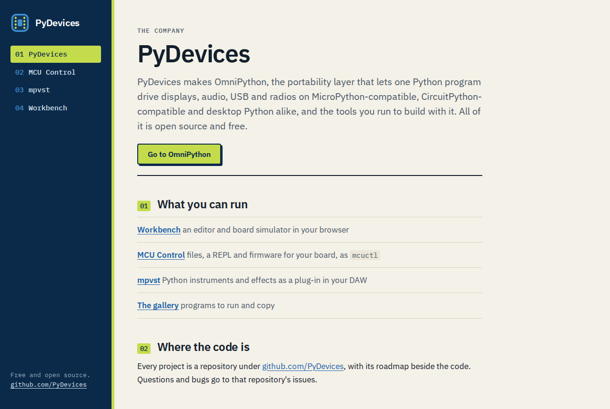

# pydevices.com

The source of <https://pydevices.com/>: the PyDevices company page and a page each for the tools you run, MCU Control, mpvst and Workbench, and one for the apps. It is plain HTML and CSS, served by GitHub Pages.

## Install

There is nothing to install to read the site. To work on it, clone it and serve it with Python 3's standard library:

```bash
git clone https://github.com/PyDevices/pydevices.com
cd pydevices.com
python3 -m http.server 8000
```

Open <http://127.0.0.1:8000/> and you get the page in the image above.

## Change a page

Each page's text is in `_src/`, and `tools/build.py` writes the pages from it with the same head and rail:

```bash
python3 tools/build.py
```

It prints the pages it wrote:

```text
apps/index.html
index.html
mcuctl/index.html
mpvst/index.html
workbench/index.html
```

[Roadmap](ROADMAP.md) | [OmniPython](https://omnipython.org/)

Made by [PyDevices](https://pydevices.com).
